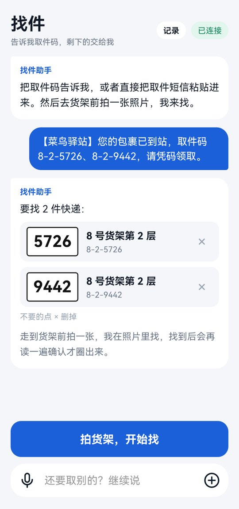
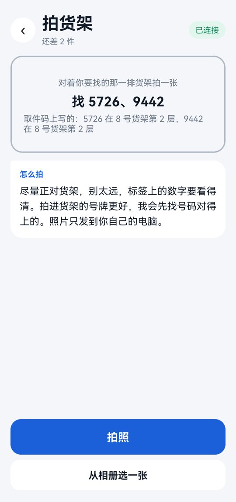
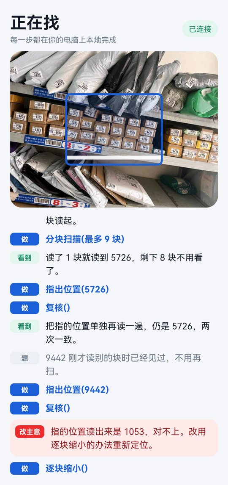
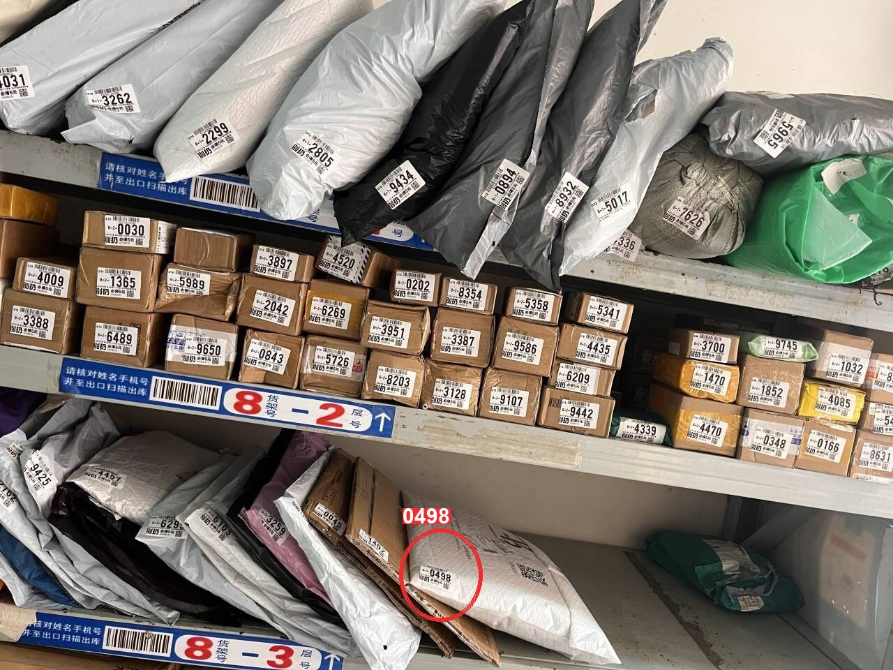

# 找件：在快递货架上帮你找到包裹的本地 Agent

## 为什么做这个

去楼下驿站取快递，取件码就在手机上，可货架上是一排排长得一模一样的方盒子，每个盒子贴着一张差不多的白标签，号码挨着号码。你只能从左到右、从上到下一个个对过去，眼睛越看越花：

- **明明就在眼前，就是没看见。** 找了两遍没找到，最后发现它就在你第一眼扫过的位置。
- **四位数字很容易看串。** `5726` 和 `5762`、`3387` 和 `3897`，扫得一快就对错了，或者直接跳过去。
- **件一多更麻烦。** 同时取三四件，每件都要重新从头找一遍；身后还有人排队等着。

人眼在一堆相似的东西里找一个特定号码，本来就不擅长；而"把每个标签都读一遍、和要找的号码逐个比对"，正好是模型擅长又不会累的事。

## 它做什么

**找件**：把取件码告诉它（打字、按住说话、或者直接发取件短信截图），对着货架拍一张，它在照片里把你的包裹找出来、圈出来，并记进取件记录。

所有识别和判断都由 **MiniCPM-V 4.7（1B）在你自己的电脑上**完成。照片里有别人的取件码和标签信息，它们不会离开你的局域网。

> 火种计划 S2 · 进阶挑战 投稿作品

| 告诉它取件码 | 拍货架（或从相册选） | 看它一步步找 |
|---|---|---|
|  |  |  |

找到后圈出来的结果（`samples/agent_result.jpg`）：



## MiniCPM 在里面做什么

这不是"调用一次模型、把结果展示出来"。Agent 每一步做什么，都由上一步模型的输出决定：

| 步骤 | MiniCPM-V 4.7 的输出 | 它决定了什么 |
|---|---|---|
| 理解请求 | 从一句话、语音转写或短信截图里找出取件码 | 要找哪几件；"验证码""电话"后面的数字不当取件码 |
| 判断照片 | 这张照片的标签能不能读清 | 读不清就**停下来请你重拍**，不硬猜 |
| 读货架号牌 | 照片里是几号货架几层 | 号码对得上的包裹先找，对不上的放到最后（从不拒绝） |
| 估计位置 | 包裹大概在照片哪一块 | 从最近的一块开始读，**读到就停**，不用读完整张 |
| 读标签 | 每一块里看到的取件码 | 找到了没有，下一步读哪一块 |
| 指出位置 | 标签在这一块里的坐标 | 圈在哪里 |
| 复核 | 把指的位置单独再读一遍 | 两次一致才圈；**不一致就改主意**，换逐块缩小的办法重新定位 |
| 没找到时 | 照片里最接近的几个号码 | 告诉你可能是看错了一位，还是这件确实不在这排 |

手机界面上把这些步骤按 想 / 做 / 看到 / 改主意 / 问你 实时列出来，扫描框跟着 Agent 正在看的位置移动。上面第三张截图里，指出 9442 的位置后复核读到的是 1053，Agent 判断对不上，改用逐块缩小重新定位，这是一次真实运行。

货架号、层号的大小比较放在代码里做：实测 1B 模型做数字比较不可靠，而它的感知（读、判断、指位置）是可靠的。分工就按这个来。

## 实测效果

在 RTX 3060 Laptop（6 GB 显存）的 Windows 笔记本上，模型用 llama.cpp 跑 Q8_0 量化：

- **读码**：样例货架照片 `samples/shelf.jpg` 上人工数出 53 个完整可见的取件码，MiniCPM-V 4.7 分块读对 **52 个**（MiniCPM-OCR 1.0 为 51 个）。脚本：`eval/read_compare.py`
- **找一件**：约 6 次模型调用，**8～11 秒**（质量检查、读号牌、估计位置、读块、指位置、复核）
- **找两件**：`8-2-5726` + `9442` 一次拍照全部找到，12 次调用，**19.1 秒**；`6-1-0498` + 只说了后四位的 `1032`，**10.9 秒**（两件离得越远、越需要复核，用时越长）
- **模糊照片**：`samples/shelf_blurry.jpg` 会被判为读不清，Agent 请你重拍，而不是给出错误位置
- **模型占用**：模型文件 1.1 GB + 视觉投影 0.86 GB，`--ctx-size 4096`

判断类能力（照片质量、号牌、请求理解）单独评测：`eval/brain_eval.py`。

## 组成

```
手机 App（uni-app x：安卓 / 鸿蒙）  ─┐
浏览器页面 web/index.html           ─┼─ 局域网 HTTP ─→ server/server.py ─→ llama-server
                                     │                  （Agent 逻辑在       （MiniCPM-V 4.7 1B）
                                     │                    server/agent.py）
                                     └─ 语音：faster-whisper，同样在电脑本地
```

| 目录 | 内容 |
|---|---|
| `server/agent.py` | Agent：解析请求、制定查找顺序、看照片、改主意、圈结果 |
| `server/server.py` | HTTP 服务（只用 Python 标准库 + Pillow），任务、照片、事件流、取件记录 |
| `app/` | uni-app x 手机客户端，用 HBuilderX 打开运行 |
| `web/index.html` | 不装 App 时用的网页版，服务启动后直接访问 |
| `prototype/index.html` | 最早的交互原型 |
| `eval/` | 读码对比、判断评测、端到端脚本 |
| `samples/` | 样例货架照片、模糊照片、取件短信截图（示例数据，号码是虚构的） |

## 运行

### 1. 启动模型

下载 [llama.cpp](https://github.com/ggml-org/llama.cpp/releases)（有 CUDA 显卡用 CUDA 版，没有用 CPU 版），以及 OpenBMB 发布的 MiniCPM-V 4.7 1B GGUF：`MiniCPM-V-4_7-1B-Q8_0.gguf` 和 `mmproj-model-f16-4x.gguf`。

```bash
llama-server -m MiniCPM-V-4_7-1B-Q8_0.gguf --mmproj mmproj-model-f16-4x.gguf \
  --host 127.0.0.1 --port 18500 --alias minicpm-v --ctx-size 4096 -ngl 99
```

### 2. 启动 Agent 服务

需要 Python 3.10+。

```bash
pip install -r requirements.txt
cd server
python server.py --port 18600 --key 你自己设一个口令
```

- 服务监听 `0.0.0.0`，同一局域网的手机可以连。Windows 上需要在防火墙放行这个端口。
- `--key` 是访问口令，手机端要填同一个。
- 语音输入需要 `faster-whisper`（已在 requirements 里），首次使用会下载 Whisper `small` 模型；可以用 `--asr-dir` 指定已下载的位置。不装也能用，只是不能按住说话。
- 运行数据（照片、取件记录）存在 `server/data/`，不会上传到任何地方。

### 3. 用起来

- **网页版**：浏览器打开 `http://电脑的局域网IP:18600/?key=你的口令`。
- **手机 App**：用 HBuilderX 打开 `app/` 目录，运行到安卓手机或鸿蒙设备。首次打开点右上角的连接状态，填服务地址 `http://电脑的局域网IP:18600` 和口令。

### 4. 不开手机，直接验证

```bash
cd eval
# 端到端：说一句话 + 一张货架照片，打印 Agent 的每一步
PARCEL_KEY=你的口令 python e2e.py http://127.0.0.1:18600 "帮我取 8-2-5726 和 9442" ../samples/shelf.jpg

# 读码召回率（直接调模型）
python read_compare.py ../samples/shelf.jpg http://127.0.0.1:18500 minicpm-v "<读码提示词>"

# 判断能力评测
python brain_eval.py ../samples/shelf.jpg --server http://127.0.0.1:18500
```

## 设计上的几个取舍

- **任何格式的取件码都收**：`8-2-5726`、`12-6029`、只说后四位 `5726` 都行。货架号只用来排查找顺序，Agent 不会因为"号牌对不上"拒绝找，也不会替你决定去哪个货架。
- **提示词里不放示例取件码**：实测 1B 模型和 Whisper 都会把提示词里的示例号码当成听到 / 看到的内容"复述"出来。模型从文字里补出的号码，也必须在原文里完整出现才采用。
- **先估位置再分块读，读到就停**：整张照片直接让模型指位置，会偏一件；分块读完再在块内指位置、再复读确认，准确且省时间。
- **只在本地**：照片里有别人的取件码和标签，所以不走任何云端接口；手机只和你自己的电脑通信。

## 已知局限

- 1B 模型对很小、很斜或被挡住一半的标签会读错或漏读，这时 Agent 会列出最接近的号码让你自己看一眼。
- 离开家里的局域网时，需要自己搭内网穿透才能用手机连回电脑。
- 鸿蒙端需要在 HBuilderX 里配置 DevEco Studio 后编译；iOS 未测试。

## 许可

MIT
